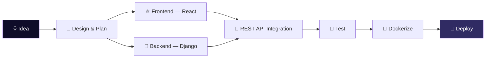

<a name="top"></a>
<div align="center">

# Hey, I'm Aditya 👋

**Software Developer · Full-Stack · Final Year CS Student**

[LinkedIn](https://www.linkedin.com/in/aditya-goswami-662581339/) •
[Portfolio](https://portfolio-aditya-05.vercel.app/) •
[Email](mailto:binarptya@gmail.com) •
[GitHub](https://github.com/coder-adi6)

*Building full-stack products end-to-end · Shipping with Django + React + PostgreSQL · Teaching machines to read contracts*


[About](#about) •
[Stack](#stack) •
[Projects](#projects) •
[Certifications](#certifications) •
[Contact](#contact)

</div>

---

<a name="about"></a>
## 🧑‍💻 About Me

I'm a final-year Computer Science student who builds things end-to-end — from REST APIs to responsive UIs. I've completed two internships, shipped real products used by real teams, and I'm always chasing the next thing to learn (and break).

<table>
<tr>
<td width="55%" valign="top">

```python
class Aditya:
    def __init__(self):
        self.role = "Software Developer"
        self.focus = ["Full-Stack", "AI/ML"]
        self.currently = "Final Year CS Student"
        self.fuel = "☕ chai"

    def debug(self):
        return "🎧 music on, bugs squashed"

    def ship(self, idea):
        return f"{idea} → production 🚀"
```

</td>
<td width="45%" valign="top">

| | |
|:---|:---|
| 🔭 Building | Full-stack products with Django + React |
| 🌱 Learning | NLP & LLM tooling |
| 💬 Ask me about | Full-stack dev, APIs |
| ⚡ Fun fact | I debug faster with music on |

</td>
</tr>
</table>

<details>
<summary><b>🧭 Experience timeline (click to expand)</b></summary>
<br/>

```text
2026 — Software Developer Intern @ PenguinApps Lab
        └─ Shipped a full-stack Task Manager
        └─ Contributed to a live client product

2025 — AI/ML Intern @ Infosys Springboard
        └─ Built a production-ready contract compliance checker
```

</details>

<details>
<summary><b>⚙️ How I build things (click to expand)</b></summary>
<br/>



</details>

---

<a name="stack"></a>
## 🛠 Tech Stack

| | |
|:---|:---|
| **Languages** | `Python` `JavaScript` `Java` `C` |
| **Web & Frameworks** | `HTML` `CSS` `React` `Django` |
| **AI / ML** | `scikit-learn` `PyTorch` `NLP` |
| **Tools & Infra** | `Git` `GitHub` `Docker` `PostgreSQL` `VS Code` |

<details>
<summary><b>📊 Proficiency (click to expand)</b></summary>
<br/>

```text
Python            █████████░  90%
Django            ████████░░  85%
React / JS        ████████░░  80%
SQL / PostgreSQL  ███████░░░  75%
NLP / ML          ███████░░░  70%
Docker            ██████░░░░  65%
```

</details>

---

<a name="projects"></a>
## 📌 Featured Projects

<table width="100%">
<tr>
<td width="50%" valign="top">

### 🗂 [Task Manager](https://github.com/coder-adi6/task-manager)

Full-stack task management app with JWT auth, project & task CRUD, and a Docker Compose setup for one-command spin-up.

`Django` `React` `PostgreSQL` `Docker`

</td>
<td width="50%" valign="top">

### 📄 [AI Compliance Checker](https://github.com/coder-adi6/AI-Powered-Regulatory-Compliance-Checker-for-Contracts)

AI-driven system that analyses contracts for GDPR, HIPAA, CCPA & SOX compliance with automated severity scoring.

`Python` `NLP` `Supervised Learning`

</td>
</tr>
<tr>
<td width="50%" valign="top">

### 🚕 [NaariCabs](https://github.com/coder-adi6/NaariCabs)

A women-safety focused cab booking concept, with a landing page and signup flow built for a smooth, trustworthy user experience.

`HTML` `CSS`

</td>
<td width="50%" valign="top">

### 🖥 [Portfolio](https://portfolio-aditya-05.vercel.app/)

Personal portfolio showcasing my dev journey, projects, and skills — built for speed and clean design. ([source](https://github.com/coder-adi6/Portfolio))

`React` `Vite`

</td>
</tr>
</table>

---

<a name="certifications"></a>
## 🏅 Certifications

| Certification | Issuer |
|:---|:---|
| 🌐 Full Stack Web Development | Physics Wallah |
| 🤖 AI Fundamentals & Generative AI | Infosys Springboard |
| 🧠 Deep Learning & NLP | Infosys Springboard |
| 📊 Data Science & Computer Vision | Infosys Springboard |
| 🐙 Mastering GitHub | Microsoft |

---

## 😄 Fun Facts

- ☕ Addicted to **chai** and clean commit messages
- 🎮 I love gaming
- 🎨 Constantly tweaking my portfolio like it's a code dojo
- 🎧 I debug faster with music on

---

### 🤝 Let's Collaborate

Open to internships, open-source contributions, and interesting full-stack side projects. If you're building something and want an extra pair of hands, reach out below.

---

<a name="contact"></a>
## 📬 Get in Touch

[LinkedIn](https://www.linkedin.com/in/aditya-goswami-662581339/) •
[Portfolio](https://portfolio-aditya-05.vercel.app/) •
[Email](mailto:binarptya@gmail.com) •
[GitHub](https://github.com/coder-adi6)

> *"Code is like humor. When you have to explain it, it's bad."* — Cory House

<p align="right"><a href="#top">⬆ back to top</a></p>
