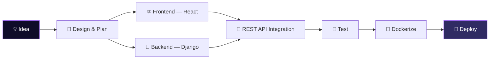
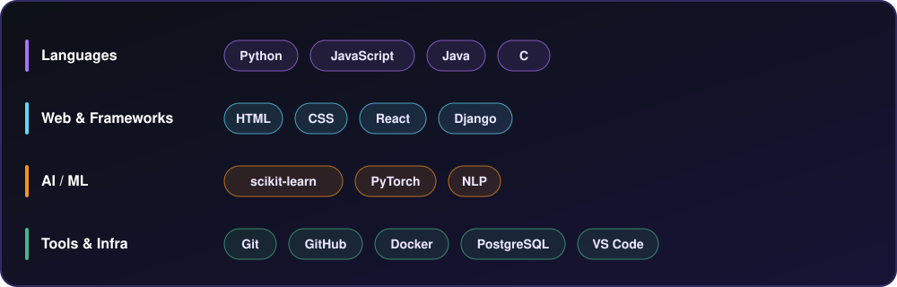

<a name="top"></a>
<div align="center">



<br/><br/>


<br/><br/>

<a href="https://www.linkedin.com/in/aditya-goswami-662581339/"></a>
<a href="https://portfolio-aditya-05.vercel.app/"></a>
<a href="mailto:binarptya@gmail.com"></a>
<a href="https://github.com/coder-adi6"></a>

<br/><br/>


<br/>

<a href="#about">About</a> •
<a href="#stack">Stack</a> •
<a href="#projects">Projects</a> •
<a href="#certifications">Certifications</a> •
<a href="#contact">Contact</a>

</div>

<br/>

<a name="about"></a>
## 🧑‍💻 About Me

I'm a final-year Computer Science student who builds things end-to-end — from REST APIs to responsive UIs. I've completed two internships, shipped real products used by real teams, and I'm always chasing the next thing to learn (and break).

<table>
<tr>
<td width="55%" valign="top">

```python
class Aditya:
    def __init__(self):
        self.role = "Software Developer"
        self.focus = ["Full-Stack", "AI/ML"]
        self.currently = "Final Year CS Student"
        self.fuel = "☕ chai"

    def debug(self):
        return "🎧 music on, bugs squashed"

    def ship(self, idea):
        return f"{idea} → production 🚀"
```

</td>
<td width="45%" valign="top">

| | |
|:---|:---|
| 🔭 Building | Full-stack products with Django + React |
| 🌱 Learning | NLP & LLM tooling |
| 💬 Ask me about | Full-stack dev, APIs |
| ⚡ Fun fact | I debug faster with music on |

</td>
</tr>
</table>

<details>
<summary><b>🧭 Experience timeline (click to expand)</b></summary>
<br/>

```text
2026 — Software Developer Intern @ PenguinApps Lab
        └─ Shipped a full-stack Task Manager
        └─ Contributed to a live client product

2025 — AI/ML Intern @ Infosys Springboard
        └─ Built a production-ready contract compliance checker
```

</details>

<details>
<summary><b>⚙️ How I build things (click to expand)</b></summary>
<br/>



</details>

<div align="center"></div>

<a name="stack"></a>
## 🛠 Tech Stack

<div align="center">

<br/><br/>

</div>

<div align="center"></div>

<a name="projects"></a>
## 📌 Featured Projects

<table width="100%">
<tr>
<td width="50%" align="center">
<a href="https://github.com/coder-adi6/task-manager"></a>
</td>
<td width="50%" align="center">
<a href="https://github.com/coder-adi6/AI-Powered-Regulatory-Compliance-Checker-for-Contracts"></a>
</td>
</tr>
<tr>
<td width="50%" align="center">
<a href="https://github.com/coder-adi6/NaariCabs"></a>
</td>
<td width="50%" align="center">
<a href="https://portfolio-aditya-05.vercel.app/"></a>
</td>
</tr>
</table>

<div align="center"></div>

<a name="certifications"></a>
## 🏅 Certifications

<div align="center">

| Certification | Issuer |
|:---|:---|
| 🌐 Full Stack Web Development | Physics Wallah |
| 🤖 AI Fundamentals & Generative AI | Infosys Springboard |
| 🧠 Deep Learning & NLP | Infosys Springboard |
| 📊 Data Science & Computer Vision | Infosys Springboard |
| 🐙 Mastering GitHub | Microsoft |

</div>

<div align="center"></div>

## 😄 Fun Facts

- ☕ Addicted to **chai** and clean commit messages
- 🎮 I love gaming
- 🎨 Constantly tweaking my portfolio like it's a code dojo
- 🎧 I debug faster with music on

<div align="center"></div>

<div align="center">

### 🤝 Let's Collaborate

Open to internships, open-source contributions, and interesting full-stack side projects.<br/>
If you're building something and want an extra pair of hands, reach out below.

</div>

<a name="contact"></a>
<div align="center">

## 📬 Get in Touch

<a href="https://www.linkedin.com/in/aditya-goswami-662581339/"></a>
<a href="https://portfolio-aditya-05.vercel.app/"></a>
<a href="mailto:binarptya@gmail.com"></a>
<a href="https://github.com/coder-adi6"></a>

<br/><br/>

> *"Code is like humor. When you have to explain it, it's bad."* — Cory House


</div>

<p align="right"><a href="#top">⬆ back to top</a></p>
